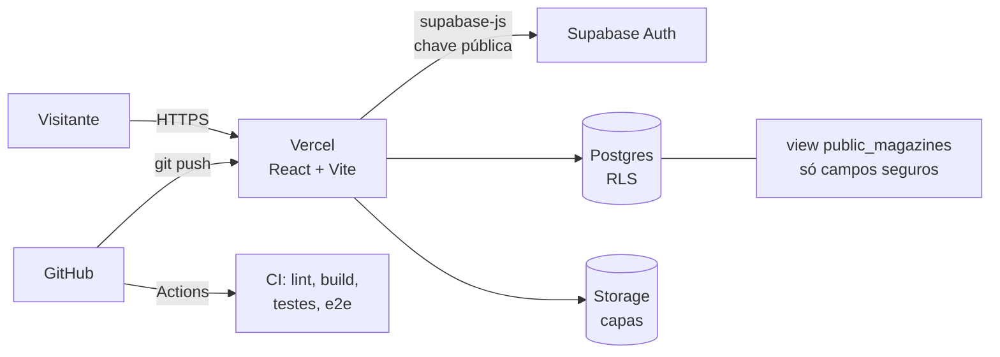

# Vault Keeper

Catálogo para organizar uma coleção de revistas, edição por edição: login, cadastro, upload de capas, filtros, importação em massa e uma página pública só para visualização.

**[Ver o projeto no ar](https://vault-keeper-zeta.vercel.app)** · [Material de estudos (19 capítulos)](estudos/) · [API em Java (projeto irmão)](#api-em-java-projeto-irmão)

> O catálogo público exibe capas de revistas adultas e por isso abre com um aviso 18+. É um projeto pessoal e sem fins lucrativos, feito para aprender desenvolvimento web de ponta a ponta.


## Em resumo

| | |
|---|---|
| **O que é** | App web completo: front-end, banco, autenticação, armazenamento de imagens e deploy. |
| **Meu papel** | Tudo: modelagem do banco, regras de segurança, interface, testes, acessibilidade, páginas legais e publicação. |
| **Stack** | React 19, TypeScript, Vite, React Router, Supabase (Postgres, Auth, Storage), Vercel, GitHub Actions. |
| **Qualidade** | 76 testes unitários e de componente, 3 testes de ponta a ponta, lint e formatação no CI. |
| **Para recrutadores** | Veja [Decisões técnicas](#decisões-técnicas) e [Limitações conhecidas](#limitações-conhecidas-e-próximos-passos): documentei o que ainda falta. |

## Funcionalidades

- **Área privada** com login: cadastro, edição e exclusão de revistas (título, edição, ano, mês, condição, notas, capa).
- **Upload de capas** para o Supabase Storage, com desfazimento do upload se o registro no banco falhar.
- **Importação em massa:** o app lê ano, mês, edição e nome a partir do nome do arquivo da capa.
- **Filtros** por título, ano, condição e situação (tenho / procurando).
- **Três modos de visualização:** vertical, horizontal (com `scroll-snap`) e mosaico.
- **Lightbox** no mosaico: abre a capa inteira, navega por setas, botões ou toque, com fundo de vidro (`backdrop-filter`).
- **Catálogo público** sem login, lendo de uma *view* que só expõe os campos seguros.
- **Tema claro e escuro**, lembrando a escolha do visitante.
- **"Mostrar mais"** em lotes de 24, em vez de desenhar a coleção inteira de uma vez.

## Arquitetura



Estrutura do código (`src/`):

```
components/   interface reutilizável (cards, formulário, lightbox, modais)
pages/        telas (início, minha coleção, catálogo público, páginas legais)
hooks/        lógica de estado reutilizável (sessão, tema, modo de visualização, foco)
lib/          lógica sem interface: filtros, leitura do nome do arquivo, serviço do banco
config/       dados do site num lugar só
```

O acesso ao banco fica **todo em um arquivo** (`lib/magazineService.ts`). Nenhum componente fala com o Supabase diretamente.

## Decisões técnicas

- **Segurança no banco, não no front-end.** A chave do Supabase fica visível no navegador (é assim em qualquer app Vite), então a proteção real é a **RLS** do Postgres: cada usuário só lê e altera as próprias linhas. A chave de serviço nunca entra no projeto.
- **Catálogo público por *view*.** Em vez de abrir a tabela para visitantes, criei a view `public_magazines` com só as colunas seguras (sem `user_id` nem notas privadas) e removi a leitura anônima da tabela.
- **Camada de serviço isolada.** Trocar o back-end não exige reescrever a interface. Foi exatamente o que permitiu começar a [API em Java](#api-em-java-projeto-irmão).
- **TypeScript estrito.** Um exemplo real: o tipo dizia `year: number`, mas o banco tinha revistas sem ano. Corrigi para `number | null` e o compilador apontou todos os lugares sem tratamento.
- **Lógica pura testada com TDD** (filtros e leitura do nome do arquivo), por render mais com menos esforço.
- **Desempenho:** telas carregadas sob demanda (`React.lazy`), reduzindo o JavaScript inicial de 148 kB para 85 kB (gzip); miniaturas redimensionadas pela Vercel, com volta à imagem original se falhar.
- **Privacidade por padrão:** fonte servida pelo próprio site (nenhum pedido sai para o Google), sem rastreadores, só `localStorage` essencial e aviso de armazenamento.
- **CSS puro** com variáveis (tokens) e `[data-theme]`, para entender a base antes de usar uma biblioteca.

## Qualidade

| Área | O que existe |
|---|---|
| **Testes unitários e de componente** | 76 testes (Vitest + Testing Library): filtros, leitura de nomes de arquivo, contraste de cores, aviso 18+, modal, lightbox, formulário (com teste de regressão de um bug real) e paginação. |
| **Ponta a ponta** | 3 testes (Playwright) com o Supabase simulado: aviso 18+, mosaico, lightbox com teclado, "Mostrar mais" e páginas legais. Também verifica que nenhuma requisição sai para domínios de terceiros. |
| **Acessibilidade** | Foco preso nas janelas, "pular para o conteúdo", `aria-label` nos controles só com ícone, títulos por página e **contraste WCAG AA verificado por teste automático**. Lighthouse da página inicial: 100 em acessibilidade. |
| **CI** | GitHub Actions roda formatação (Prettier), lint (oxlint), TypeScript, build, testes e e2e a cada push e pull request. |
| **LGPD** | Política de privacidade, termos de uso, aviso de direitos autorais com canal de remoção e aviso de armazenamento. Os textos são modelos, sem parecer jurídico. |

## Como rodar

Pré-requisitos: Node 24 e um projeto no [Supabase](https://supabase.com).

```bash
git clone https://github.com/unknownit88/vault-keeper.git
cd vault-keeper
npm install
```

Crie o arquivo `.env.local` com a URL e a chave **pública (publishable/anon)** do seu projeto:

```bash
VITE_SUPABASE_URL=https://<seu-projeto>.supabase.co
VITE_SUPABASE_PUBLISHABLE_KEY=<chave-publica>
```

Para criar as tabelas e as regras de segurança, aplique os arquivos de `supabase/migrations/` na ordem.

```bash
npm run dev          # servidor de desenvolvimento
npm test             # testes unitários e de componente
npm run test:e2e     # testes de ponta a ponta (instale o navegador: npx playwright install chromium)
npm run lint         # oxlint
npm run build        # TypeScript + build de produção
```

## API em Java (projeto irmão)

Para praticar back-end, estou refazendo a mesma API em **Java 17 e Spring Boot 3** (repositório local, ainda não publicado), reaproveitando o mesmo front-end:

- CRUD com DTOs (`record`), validação (`jakarta.validation`) e tratamento centralizado de erros.
- Login com **JWT** (Spring Security, BCrypt) e CORS por configuração.
- JPA/Hibernate sobre H2 nos testes e perfil para o Postgres do Supabase.
- 20 testes automatizados (MockMvc e `@DataJpaTest`), incluindo isolamento entre usuários.

## Limitações conhecidas e próximos passos

Gosto de deixar claro o que ainda não está pronto:

- **Endurecimento do banco:** a migration `20261101100000_harden_rls_privileges_bucket.sql` (RLS otimizada, privilégios mínimos, limite do bucket, chave estrangeira) está escrita e revisada, mas **ainda não foi aplicada em produção**.
- **Verificação de idade:** o aviso 18+ é declaratório, sem verificação real.
- **Direitos de terceiros:** as capas pertencem aos seus titulares. O projeto é pessoal, sem fins lucrativos, e tem canal de remoção.
- **Monitoramento de erros:** há um `ErrorBoundary`, mas ainda sem serviço de monitoramento (por exemplo, Sentry).
- **API Java:** o código está pronto para o Postgres do Supabase, mas ainda não foi ligada ao banco real nem publicada.

## Material de estudos

Documentei tudo o que aprendi em [`estudos/`](estudos/): 19 capítulos, do JavaScript e TypeScript até segurança, deploy e um roteiro de entrevista técnica. Há também uma versão em PDF.

## Contato

Aberto a oportunidades de **estágio e vaga júnior em desenvolvimento**, com disponibilidade para viagens e mudança de cidade.

- E-mail: ff.pradocarvalho@gmail.com
- GitHub: [@unknownit88](https://github.com/unknownit88)
